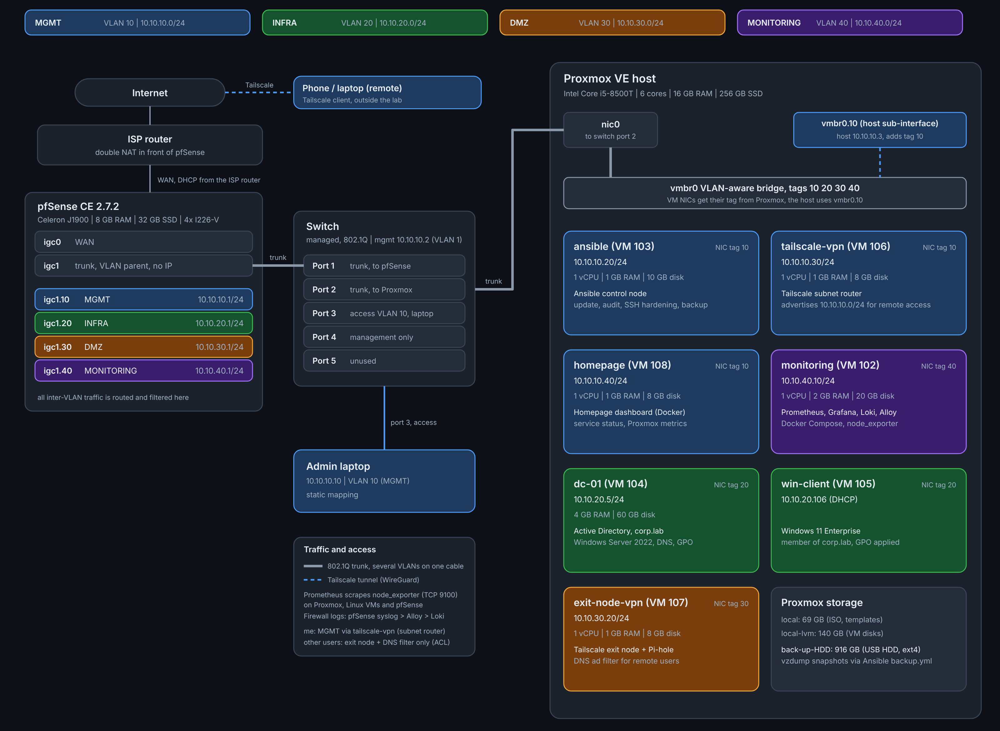

# Segmented Office Network

A small office network on real hardware (pfSense, managed switch, Proxmox), split into four zones. The firewall blocks everything except what is needed, and every rule is tested and documented. Also includes monitoring with Telegram alerts, Ansible automation and a Windows domain.

## Topology

## Security zones

| Zone | VLAN | Subnet | Gateway | Purpose |
|---|---|---|---|---|
| MGMT | 10 | 10.10.10.0/24 | 10.10.10.1 | Administration: Proxmox, switch, admin PC |
| INFRA | 20 | 10.10.20.0/24 | 10.10.20.1 | Internal servers |
| DMZ | 30 | 10.10.30.0/24 | 10.10.30.1 | VPN exit node with DNS filter |
| MONITORING | 40 | 10.10.40.0/24 | 10.10.40.1 | Metrics collection and dashboards |

## Security model

- **Default deny.** Nothing is allowed unless a rule says so.
- **No jumping between zones.** INFRA, DMZ and MONITORING cannot reach any private network, only DNS, ping and the internet.
- **Management is separate.** Only the admin PC and the Ansible node can administer the lab.

Full access summary: [03 Firewall rules](docs/03-firewall-rules.md).

## Documentation

| Document | Content |
|---|---|
| [01 Topology](docs/01-topology.md) | Hardware, cabling, switch ports |
| [02 VLANs and addressing](docs/02-vlans-addressing.md) | VLAN IDs, subnets, DHCP, Proxmox bridge |
| [03 Firewall rules](docs/03-firewall-rules.md) | Aliases and rules per interface |
| [04 Verification](docs/04-verification.md) | Test matrix: command, expectation, result |
| [05 Monitoring](docs/05-monitoring.md) | Prometheus, Grafana, alerts, Homepage |
| [06 Troubleshooting](docs/06-troubleshooting.md) | Real problems, their causes and fixes |
| [07 Automation](docs/07-automation.md) | Ansible control node and playbooks |
| [08 Active Directory](docs/08-active-directory.md) | Domain corp.lab: OUs, Group Policy, delegation, file share |
| [Configs](configs/) | Configuration files (secrets removed) |
| [Screenshots](screenshots/README.md) | Screenshots of rules, tests, monitoring and AD |

## Tech stack

pfSense CE 2.7.2, Proxmox VE, Debian 13, Windows Server 2022 (Active Directory, DNS, Group Policy), Windows 11, Docker, Prometheus, Grafana, Loki, node_exporter, Ansible, Tailscale, Pi-hole, Homepage, 802.1Q VLANs.

## Roadmap

- [x] Replace MGMT *pass any* with explicit rules
- [x] Active Directory (Windows Server, domain `corp.lab`) in INFRA
- [x] Ansible control VM (`ansible`, MGMT): update and audit playbooks with reports
- [x] Ansible: SSH hardening (key-only), audit and backup playbooks
- [ ] Lynis hardening score
- [x] Firewall log pipeline: pfSense syslog, Alloy, Loki, Grafana dashboard
- [x] Backup storage on a separate HDD
- [x] Admin remote access into MGMT (Tailscale subnet router)
- [x] VPN exit node in DMZ with DNS ad filtering (Pi-hole) and a restrictive Tailscale access policy
- [x] Homepage dashboard (service status and Proxmox metrics from Prometheus)
- [x] Alerting in monitoring (Grafana rules to Telegram: target down, disk, Proxmox temperature)
- [ ] Suricata IDS on the DMZ
- [ ] DMZ service published through a Cloudflare Tunnel
- [ ] Hybrid cloud connectivity (site-to-site VPN, then BGP)
