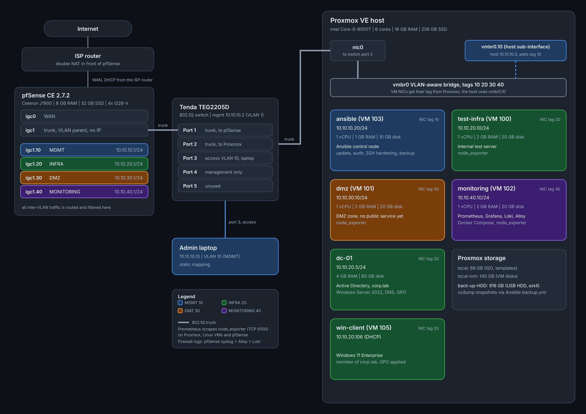

# Segmented Office Network

A small-office network built on real hardware: a pfSense firewall, a VLAN-capable managed switch and a Proxmox hypervisor. The lab implements zone-based segmentation with least-privilege firewall policy, centralized monitoring and documented verification of every rule. It also includes Ansible automation and an Active Directory domain.

## Goals

- Segment a flat network into four security zones using 802.1Q VLANs.
- Enforce inter-zone policy on a stateful firewall (default deny, narrow exceptions).
- Monitor the hypervisor, the Linux VMs and the firewall with Prometheus and Grafana.
- Automate routine administration with Ansible: patching, audit, SSH hardening, backups.
- Run a Windows domain the way a small company would: OUs, groups, Group Policy, helpdesk delegation, role-based file access.
- Prove the policy works with documented tests, and record the problems found along the way.

## Topology

## Security zones

| Zone | VLAN | Subnet | Gateway | Purpose |
|---|---|---|---|---|
| MGMT | 10 | 10.10.10.0/24 | 10.10.10.1 | Administration: hypervisor, switch, admin workstation |
| INFRA | 20 | 10.10.20.0/24 | 10.10.20.1 | Internal servers |
| DMZ | 30 | 10.10.30.0/24 | 10.10.30.1 | Internet-facing services, VPN exit node |
| MONITORING | 40 | 10.10.40.0/24 | 10.10.40.1 | Metrics collection and dashboards |

## Security model

1. **Default deny.** Nothing is allowed unless a rule says so.
2. **Zones cannot reach private networks.** INFRA, DMZ and MONITORING each have a *Block any to RFC1918* rule above their internet-access rule. This stops lateral movement and also keeps VMs away from the ISP router and the hypervisor.
3. **Narrow exceptions above the block.** DNS and ICMP to the zone's own gateway; for INFRA also web ports (80/443) and NTP to the internet; for MONITORING, TCP/9100 from one host to the exporter list.
4. **Management is separate.** The hypervisor lives in its own VLAN. The management network is the only one that can reach it.

### Access matrix (as built)

| From \ To | MGMT | INFRA | DMZ | MONITORING | Internet |
|---|---|---|---|---|---|
| MGMT | n/a | SSH from admin PC and ansible; RDP to dc-01 from the same hosts | SSH only, from admin PC and ansible | SSH, Grafana, Prometheus (admin PC) | web (80/443), NTP |
| INFRA | blocked | n/a | blocked | blocked | web (80/443), NTP |
| DMZ | blocked | blocked | n/a | blocked | web (80/443), NTP |
| MONITORING | blocked | 9100 only | 9100 only | n/a | web (80/443), NTP |

Admin access is limited to two hosts: the admin workstation (10.10.10.10) and the Ansible control node (10.10.10.20). Proxmox is reachable on 22 and 8006 only.

All zones may also use the DNS resolver and answer ICMP on their own gateway address.

## Documentation

| Document | Content |
|---|---|
| [01 Topology](docs/01-topology.md) | Hardware, cabling, switch port map |
| [02 VLANs and addressing](docs/02-vlans-addressing.md) | VLAN IDs, subnets, DHCP, Proxmox bridge |
| [03 Firewall rules](docs/03-firewall-rules.md) | Aliases and rules per interface |
| [04 Verification](docs/04-verification.md) | Test matrix: command, expectation, result |
| [05 Monitoring](docs/05-monitoring.md) | Prometheus, Grafana, node_exporter |
| [06 Troubleshooting](docs/06-troubleshooting.md) | Real problems, root causes and fixes |
| [07 Automation](docs/07-automation.md) | Ansible control node, playbooks, design decisions |
| [08 Active Directory](docs/08-active-directory.md) | Domain corp.lab, OUs, Group Policy, delegation, file share |
| [Configs](configs/) | Sanitized configuration files |
| [Screenshots](screenshots/README.md) | Evidence: screenshots of rules, tests, monitoring and AD |

## Tech stack

pfSense CE 2.7.2, Proxmox VE, Debian 13, Windows Server 2022 (Active Directory, DNS, Group Policy), Windows 11, Docker, Prometheus, Grafana, Loki, node_exporter, Ansible, 802.1Q VLANs.

## Roadmap

- [x] Replace MGMT *pass any* with explicit rules
- [x] Active Directory (Windows Server, domain `corp.lab`) in INFRA
- [x] Ansible control VM (`ansible`, MGMT): update and audit playbooks with reports
- [x] Ansible: SSH hardening (key-only), audit and backup playbooks
- [ ] Lynis hardening score
- [x] Firewall log pipeline: pfSense syslog, Alloy, Loki, Grafana dashboard
- [x] Backup storage on a separate HDD
- [x] Admin remote access into MGMT (Tailscale subnet router)
- [x] VPN exit node in DMZ with DNS ad filtering (AdGuard Home) and a restrictive Tailscale access policy
- [ ] Suricata IDS on the DMZ
- [ ] DMZ service published through a Cloudflare Tunnel
- [ ] Hybrid cloud connectivity (site-to-site VPN, then BGP)
- [ ] Alerting system in monitoring
