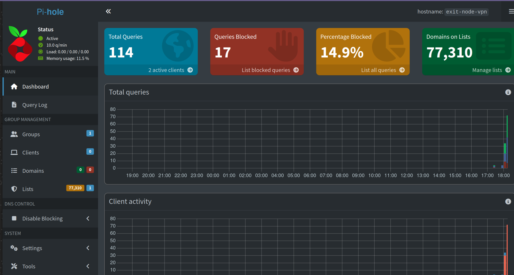

# 01. Topology

## Hardware

| Device | Role | Notes |
|---|---|---|
| Mini PC, Celeron J1900 | pfSense CE 2.7.2 firewall | 8 GB DDR3L, 32 GB SSD, 4x Intel I226-V |
| Tenda TEG2205D | Managed 5-port gigabit switch, 802.1Q | Management IP 10.10.10.2 (stays in VLAN 1) |
| Proxmox VE host | Hypervisor | 16 GB RAM, management IP 10.10.10.3 |
| Laptop | Admin workstation | Static mapping 10.10.10.10 |
| ISP router | Upstream | Double NAT in front of pfSense |

## pfSense interfaces

| Interface | Role |
|---|---|
| igc0 | WAN, DHCP from the ISP router |
| igc1 | Trunk to the switch. No IP, parent for VLAN 10/20/30/40 |
| igc2, igc3 | Spare |

`igc1` has no IP and no allow rules, but it must stay enabled. If it is disabled, the link and all VLANs on it go down.

## Switch port map

| Port | Mode | VLANs | Connected to |
|---|---|---|---|
| 1 | Trunk | tagged 10, 20, 30, 40; PVID 1 | pfSense igc1 |
| 2 | Trunk | tagged 10, 20, 30, 40; PVID 1 | Proxmox host |
| 3 | Access | PVID 10 | Admin laptop |
| 4 | Access | PVID 1 | Switch management only (manual 10.10.10.50/24) |
| 5 | Unused | | |

## Design: router-on-a-stick

One cable (igc1) carries all VLANs as 802.1Q tags. pfSense routes every VLAN, so all traffic between zones goes through the firewall. The switch only forwards frames and makes no policy decisions.

Proxmox uses a VLAN-aware bridge. Each VM NIC gets its VLAN tag in the Proxmox settings.

pfSense sits behind the ISP router (double NAT). Outbound traffic works normally. Port forwarding is not planned: access to DMZ services is meant to use an outbound-only Cloudflare Tunnel.

## Remote access

The VM `tailscale-vpn` (10.10.10.30, MGMT) is a Tailscale subnet router. It advertises `10.10.10.0/24` and one host route, `10.10.40.10/32` (Grafana and Prometheus). A remote laptop or phone reaches MGMT and the monitoring host as if it were connected by cable. The rest of the MONITORING zone stays unreachable from the VPN. No port is forwarded, because the VM connects out to Tailscale.

- Remote traffic leaves the VM with its own address (10.10.10.30) as source, so MGMT rules 4 and 5 are needed for Grafana, Prometheus and the pfSense GUI. Other zones are not advertised.
- Login uses an external identity account with two-factor authentication. Key expiry is disabled for the node, so the route does not drop silently.
- Clients use `tailscale up --accept-routes` (Linux) or the phone app.

The VM `homepage` (10.10.10.40, MGMT) shows the state of the lab on one page, see [05 Monitoring](05-monitoring.md).

### Exit node and DNS filter

A second Tailscale node, `exit-node-vpn` (10.10.30.20, DMZ), is an exit node: remote devices can send all internet traffic through the home connection. It runs Pi-hole (StevenBlack blocklist, about 77,000 domains). The Tailscale admin console points the tailnet DNS at it (with *Override local DNS*), so remote devices get ad and tracker blocking while the exit node is used. The web interface opens by node name over Tailscale: `http://exit-node-vpn/admin`.

- The node is in the DMZ on purpose. DMZ rules block every private network, so other people's traffic cannot reach MGMT or INFRA, even if a device is compromised.
- The node has the tag `tag:exit`. The Tailscale access policy gives a restricted group only DNS (port 53) on that tag and the internet. The policy has `tests` that fail the save if a restricted user could reach Proxmox, the pfSense GUI or the VPN node.
- Limits: DNS filtering does not remove ads served from the same domain as the content (for example YouTube video ads), and all traffic leaves with the home IP address.
